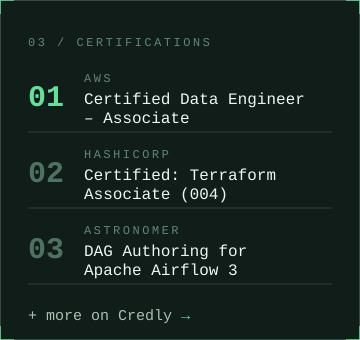

<table>
  <tr>
    <td colspan="2"></td>
  </tr>
  <tr>
    <td width="50%" valign="top"></td>
    <td width="50%" valign="top"></td>
  </tr>
  <tr>
    <td colspan="2"></td>
  </tr>
</table>

## About

Senior AI Data Engineer and freelancer, building and optimizing data pipelines and large-scale data processing. Interests: Data Engineering, Cloud, AI, Automation.

## Currently

- Building side projects
- Exploring AI agents and LLM-powered workflows
- Experimenting with new technologies

## Certifications

- [AWS Certified Data Engineer – Associate](https://www.credly.com/badges/01ff15f9-b7e2-4af1-a702-b053151e4503)
- HashiCorp Certified: Terraform Associate (004)
- Astronomer Certification: DAG Authoring for Apache Airflow 3
- More certifications on Credly

## Connections

[LinkedIn](https://www.linkedin.com/in/lucjankonopka/) · Credly · [GitHub Projects](https://github.com/lucjankonopka?tab=repositories)
