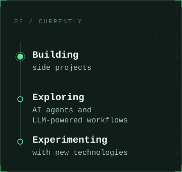
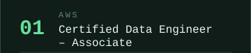
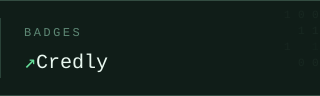
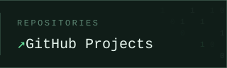

<table>
  <tr>
    <td colspan="2"><picture></picture></td>
  </tr>
  <tr>
    <td width="50%" valign="top"><picture></picture></td>
    <td width="50%" valign="top"><picture></picture></td>
  </tr>
  <tr>
    <td colspan="2"></td>
  </tr>
</table>

